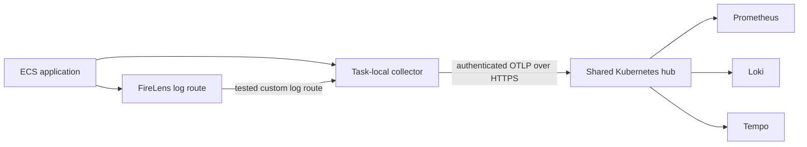

# lgtm-stack

LGTM Lite as ArgoCD Applications: Prometheus + Alertmanager (kube-prometheus-stack), Grafana, Loki, Alloy, Tempo and
the OpenTelemetry Operator, with the Spartan presets built in. The chart renders **ArgoCD Application CRs** (app of
apps), not the workloads themselves, so each component keeps its own sync wave, retries and ignored diffs.

A project installs it as one Application and keeps one values file. Updating the stack is a chart version bump.

## Tenant dashboard delivery

Tenant organization mapping and confined parent folders are enabled exactly when at least one tenant has
non-empty `tenants[].grafana.viewers` or `editors` groups. The rule applies to the whole tenant list.
Dashboard delivery starts per tenant when `tenants[].grafana.orgId` is set and requires org mapping to be enabled.
When at least one tenant has an org id, the main sidecar watches only
`grafana.tenantDashboards.platformNamespaces` (default `[monitoring]`). This list must be nonempty and
must not contain any tenant namespace. Delivery overrides through `extraContainers`, `extraVolumes`,
`extraVolumeMounts`, `extraObjects`, `sidecar.dashboards.searchNamespace` or the generated
`dashboardProviders.tenant-dashboardproviders.yaml` key in `components.grafana.values` are rejected.
Without any org ids, dashboard delivery settings and validations do not apply; the main sidecar is unchanged.

Set `tenants[].grafana.orgId` only after the org exists, using the numeric id logged by the tenant-orgs job.
Grafana org ids autoincrement and are not reused; after a Grafana DB reset or org deletion, unset the stale `orgId` or re-read it from the job log before the next sync.
A provider for a missing org makes Grafana exit 1. First add tenant Grafana groups and sync without `orgId` to create the org and folder; a second
change sets its id. A tenant without an id gets no dashboard sidecar, providers or sentinel.
Never delete the org or reset the Grafana database while its id is set. For recovery, unset `orgId`
then sync so Grafana starts without the missing-org provider.

Each tenant configured with namespaces and a Grafana org id gets a sidecar watching its `namespaces`, two providers in its org and folder
with uid equal to the tenant id, and an unlabelled home ConfigMap delivered through Grafana's `extraObjects`.
The protected `<tenant>-home` dashboard prevents deletion of the parent folder. Git dashboards are read-only;
copy them into the tenant folder to edit them.

Tenant dashboards appear within about 30 seconds through provider polling. The tenant sidecar holds no Grafana credential.
The sidecar can still fetch `.url` annotated keys; no Grafana credential is sent with those requests.
Only the parent folder's permission list is replaced. Grants a tenant creates on its own sub-folders stay;
this is harmless because the Grafana org is the confinement boundary and sub-folders cannot leave the parent.
Tenant dashboard ids `general` and `volume`, and ids that cause generated volume or provider name collisions, are rejected.
Tenant ConfigMaps use this shape:

```yaml
apiVersion: v1
kind: ConfigMap
metadata:
  name: alpha-dashboard-overview
  namespace: alpha-dev
  labels:
    grafana_dashboard: "1"
data:
  overview.json: |
    {"uid":"alpha-overview","title":"Overview","panels":[]}
```

Use tenant-prefixed uids, never `<tenant>-home`; omit top-level `id` and `__inputs`. Use datasource
uids `prometheus`, `loki`, `tempo`, with tenant namespace filters. Files land flat in the tenant folder;
`grafana_folder` annotations are ignored. ConfigMaps must be on Grafana's cluster: a production Grafana
cannot watch ConfigMaps on a separate development cluster. Both dashboard mounts are outside `/tmp/dashboards`
so the main-org provider cannot load tenant files.

## Install

The project's ArgoCD repo wraps the chart, so Dependabot's `helm` ecosystem opens a PR for every new version.

```yaml
# lgtm-stack/Chart.yaml
apiVersion: v2
name: lgtm-stack-<cluster>
version: 1.0.0
dependencies:
  - name: lgtm-stack
    version: 0.21.0
    repository: https://spartan-stratos.github.io/helm-charts
```

```yaml
# lgtm-stack/values.yaml (values go under the dependency name)
lgtm-stack:
  argocd:
    project: <argocd project>
    destination: { name: <target cluster> }
  cluster:
    name: <cluster name>
```

```yaml
# apps/lgtm-stack.yaml, read by the project's root Application
apiVersion: argoproj.io/v1alpha1
kind: Application
metadata:
  name: lgtm-stack
  namespace: argocd
spec:
  project: <argocd project>
  destination:
    name: in-cluster        # the ArgoCD cluster: the chart renders Application CRs
    namespace: argocd
  source:
    repoURL: <this repo>
    targetRevision: master
    path: lgtm-stack
    helm:
      releaseName: lgtm-stack
  syncPolicy:
    automated: { prune: true, selfHeal: true }
```

The AppProject must allow this Helm repository, the upstream chart repositories in `values.yaml`, the ArgoCD
namespace on the ArgoCD cluster (for the Application CRs) and the target cluster. It must also allow the
cluster-scoped kinds the charts render: Namespace, CustomResourceDefinition, ClusterRole, ClusterRoleBinding,
MutatingWebhookConfiguration and ValidatingWebhookConfiguration.

Before the first sync, the target cluster needs the `gp3-enc-retain` StorageClass (EBS CSI driver, gp3, encrypted,
`Retain`, `WaitForFirstConsumer`, expansion allowed). The `eks-lgtm` Terraform module creates it with the node.

## What gets created

| Application | Wave | Source |
|---|---|---|
| `lgtm-cluster-info` | 10 | ConfigMap `monitoring-cluster-info` (`CLUSTER_NAME`, read by Alloy) |
| `lgtm-prometheus-operator-crds` | 20 | `prometheus-operator-crds` |
| `lgtm-kube-prometheus-stack` | 30 | `kube-prometheus-stack` + `presets/kube-prometheus-stack.yaml` |
| `lgtm-pvc-fill-rules` | 31 | PrometheusRule `lgtm-pvc-fill` |
| `lgtm-alertmanager-config` | 32 | AlertmanagerConfig `slack` (only with `alerting.slack.enabled`) |
| `lgtm-service-rules` | 33 | PrometheusRule `lgtm-service-red` from `alerting.rules.services` |
| `lgtm-workload-rules` | 34 | PrometheusRule `lgtm-workloads` from `alerting.rules.workloads` |
| `lgtm-stack-rules` | 35 | PrometheusRule `lgtm-stack`: Loki, Tempo or Alloy dropping data |
| `lgtm-grafana` | 40 | `grafana` + `presets/grafana.yaml` (+ `grafana-sso-<provider>.yaml`) |
| `lgtm-dashboards` | 41 | Dashboard ConfigMaps from `files/dashboards/` |
| `lgtm-project` | 42 | The project folder: its dashboards and rules (only with `project.enabled`) |
| `lgtm-log-rules` | 49 | Tenant rule ConfigMap read permissions, platform canary and ruler health alerts (only with `logRules.enabled` and tenant namespaces) |
| `lgtm-loki` | 50 | `loki` + `presets/loki.yaml` |
| `lgtm-grafana-datasources` | 51 | Loki and Tempo datasource ConfigMaps |
| `lgtm-alloy` | 52 | `alloy` + `presets/alloy.yaml` |
| `lgtm-tempo` | 60 | `tempo` + `presets/tempo.yaml` |
| `lgtm-opentelemetry-operator` | 61 | `opentelemetry-operator` + `presets/opentelemetry-operator.yaml` |
| `lgtm-instrumentation` | 62 | Instrumentation `monitoring/default` |

Everything lands in namespace `monitoring`; the presets reference each other through `*.monitoring.svc.cluster.local`.
Apps send OTLP to `http://alloy.monitoring.svc.cluster.local:4318`.

The plain manifests (rows without an upstream chart) are rendered by this same chart in addon mode: their
Applications point back at `lgtm-stack` at the same version, so the whole stack moves with one version.

## Values

Each component's Helm values are built in this order, later wins:

1. `presets/<component>.yaml`
2. `placement`: nodeSelector and tolerations at every pod path the chart has (e.g. all six in kube-prometheus-stack)
3. settings derived from the top-level values (`cluster.name`, `grafana.*`, `alerting.*`)
4. `components.<component>.values`

The merge is key by key and keeps `false`, `""` and `null` from the later layer; a `null` removes the upstream chart's
default. Lists are replaced, not appended.

| Value | Default | Description |
|---|---|---|
| `argocd.project` | `""` | AppProject for the Applications. Required |
| `argocd.destination.name` / `.server` | `""` | Target cluster. One is required |
| `argocd.namespace` | `argocd` | Namespace of the Application CRs |
| `argocd.namePrefix` | `lgtm-` | Application name prefix |
| `argocd.syncPolicy` | automated, retry 10 | Shared syncPolicy. `RespectIgnoreDifferences=true` is added where diffs are ignored |
| `cluster.name` | `""` | `cluster` label on metrics, logs and Slack messages. Required |
| `tenantIsolation.enabled` | `false` | Enable tenant logs and traces only when backend tenant authentication is enabled |
| `logRules.enabled` | `false` | Enable tenant Loki rules; requires Loki, tenant isolation and explicit Loki authentication |
| `logRules.sidecar.image` | `docker.io/kiwigrid/k8s-sidecar:2.11.2` | Rule ConfigMap watcher image |
| `logRules.sidecar.resources` | requests: 10m CPU, 64Mi; memory limit: 128Mi | Resources per tenant sidecar |
| `logRules.limits.maxRuleGroupsPerTenant` / `.maxRulesPerRuleGroup` | `10` / `10` | Maximum groups per tenant and rules per group |
| `tenants[].ruleNamespaces` | tenant's `namespaces` | Subset containing rule ConfigMaps on the Loki cluster |
| `placement.nodeSelector` / `.tolerations` | `{}` / `[]` | Pin every pod, e.g. to a dedicated node. Alloy and node-exporter (DaemonSets that read their own node) take only the tolerations, so they run on every node the tolerations admit; with a nodeSelector Alloy's Service uses `internalTrafficPolicy: Cluster`. To cover node pools with other taints, override both DaemonSets' tolerations under `components` |
| `grafana.domain` | `""` | `root_url` and Ingress host |
| `grafana.ingress.enabled` / `.className` / `.annotations` | `false` / `alb` / `{}` | Grafana Ingress |
| `grafana.sso.provider` | `none` | `keycloak` or `github` adds the matching preset; settings in `grafana.sso.<provider>` |
| `alerting.slack.enabled` | `false` | Slack receiver for warning and critical alerts |
| `alerting.slack.secretName` / `.secretKey` | `alert-slack` / `webhook-url` | Secret holding the Slack webhook URL |
| `components.<c>.enabled` | `true` | Drop a component |
| `components.<c>.chart` | pinned | Upstream chart repoURL, name and version |
| `components.<c>.values` | `{}` | Any value of the upstream chart, merged last |
| `components.<c>.ignoreDifferences` | `[]` | Appended to the built-in list |
| `addons.<a>.enabled` | `true` | `clusterInfo`, `pvcFillRules`, `stackRules`, `grafanaDatasources`, `instrumentation`, `dashboards` |
| `alerting.rules.services.*` | on, see [Service alerts](#service-alerts) | RED alerts per service; thresholds, `minRequestRate`, `overrides.<service>` |
| `alerting.rules.workloads.*` | on, `memoryLimitRatio: 0.9` | See [Workload alerts](#workload-alerts) |
| `project.enabled` | `false` | Sync the project folder (dashboards and rules) from the project's repo, see [Project folder](#project-folder) |
| `project.repoURL` / `.path` / `.targetRevision` | `""` / `""` / `HEAD` | Where that folder is. `repoURL` and `path` are required |
| `self.*` | this chart's repo and version | Where the addon Applications pull this chart; set `repoURL` (git), `path` and `targetRevision` to test a branch |

### NetworkPolicy

`networkPolicy.enabled` defaults to `false`. Enabling it creates a separate `lgtm-network-policy` addon Application.
Its four ingress-only policies fence Loki, Tempo, Prometheus and Alertmanager pods in `namespace`.
They allow pods from that namespace and namespaces in `networkPolicy.allowFromNamespaces` (default `[]`) on all ports.
Grafana, the gateway, Alloy and prom-label-proxy are not fenced. Egress is unchanged.
This is a no-op unless the cluster CNI enforces NetworkPolicy. Check kubelet probe reachability when enforcement is turned on.

Rollback: set `networkPolicy.enabled: false`, sync, and verify the `lgtm-network-policy` child Application and its four NetworkPolicies are pruned.
Before enabling a Kubernetes receiver's log or trace forwarding, check that each SDK's logs and spans carry the resource `k8s.namespace.name`; otherwise they are dropped. ECS receivers use the separate identity contract below.

Tenant receiver lists must contain at least one receiver, and receiver paths must start with `/`.
Kubernetes receiver logs and traces without a resource namespace are dropped; namespace-less metrics remain accepted for ruler namespace injection.

### Secrets

The presets expect these Secrets in `monitoring`. They are not created by the chart; use External Secrets or create
them by hand.

| Secret | Keys | Used by |
|---|---|---|
| `grafana-admin` | `admin-user`, `admin-password` | Grafana admin. Set `components.grafana.values.admin.existingSecret: ""` to let the Grafana chart generate one |
| `grafana-secret-key` | `secret-key` | Grafana `secret_key` |
| `grafana-oauth` | `client-secret` | Grafana SSO, with `grafana.sso.provider` set |
| `alerting.slack.secretName` | `alerting.slack.secretKey` | Slack webhook URL. Required for Alertmanager reconciliation when Slack is enabled |

With `alerting.slack.enabled`, both the webhook Secret and AlertmanagerConfig `slack` must exist in `monitoring`.
The operator fails reconciliation with `failed to get global AlertmanagerConfig` when the global configuration is missing;
a missing webhook Secret also prevents reconciliation. Create the Secret before enabling Slack and sync the configuration addon.

### Tenant isolation

Namespace-scoped kube-state-metrics and kubelet series gain `tenant=<id>` so tenant rulers using prom-label-proxy can query their pods and containers; tenant relabel rules precede preserved consumer lists.

Tenant ids must match `^[a-z0-9]([a-z0-9-]*[a-z0-9])?$` and contain at most 30 characters.
They use lowercase letters, digits and internal hyphens, starting and ending with a letter or digit.
The configured `platformTenant` (default `platform`) `fake` (Loki) and `single-tenant` (Tempo) are reserved tenant ids.
Tenant ids and gateway receiver ports must be unique. Ports must be integers in 1024..65535.

#### Tenant gateway receivers

A legacy tenant uses tenant-level `port` and `htpasswdSecret`, with ingress path `/<id>`.
To isolate environments under one tenant id, use `receivers` instead of those two tenant-level fields:

```yaml
tenants:
  - id: example
    namespaces: [example-dev, example-prod]
    receivers:
      - name: dev
        port: 4320
        path: /example
        namespaces: [example-dev]
        htpasswdSecret: { name: example-dev-otlp, key: htpasswd }
      - name: prod
        port: 4321
        ingress: false
        namespaces: [example-prod]
        htpasswdSecret: { name: example-prod-otlp, key: htpasswd }
gateway:
  ingress:
    enabled: true
    host: otlp.example.com
```

Each receiver has its own port, auth file and identity filter, while all receivers write the same tenant id.
Receiver names must be unique within a tenant and DNS-1123 labels of at most 63 characters.
Kubernetes receivers require a non-empty namespace list drawn from the tenant's namespaces.
The tenant-level namespace union bounds Kubernetes receiver allowlists and controls Kubernetes rulers and dashboard collection.
The label proxy enforces the tenant label only; it does not restrict queries to that namespace union.

| Receiver key | Meaning |
|---|---|
| `mode` (optional string) | Defaults to `kubernetes`. Explicit `ecs` selects the account/cluster/service contract below. |
| `stampNamespace` (optional string) | After the receiver's filter, overwrite `k8s.namespace.name` (and the metric datapoint `namespace`, and a log or span `namespace` attribute where the sender set one) with this value on every signal. The filter still checks the sender's original namespace against `namespaces`. Requires non-empty `namespaces`. Use it so a dev receiver on a shared tenant writes `<ns>-dev` and can never write the prod namespace. Unset renders unchanged. |

Receiver paths default to `/<id>/<name>`; `ingress` defaults to true. Paths must be unique across all lanes,
and ingress paths cannot contain another ingress path at a `/` boundary. With `ingress: false`, send directly to
`http://alloy-gateway.monitoring.svc.cluster.local:<port>/<id>/<name>/v1/{metrics,logs,traces}`
(use the configured path when overridden). Public receivers use the ingress host and the same signal suffixes.
For Kubernetes receivers, namespace-less metrics still pass the filters; separate receivers do not close that existing gap. Logs and spans without a resource `k8s.namespace.name` are dropped.

The platform must label each tenant namespace `lgtm-stack/tenant=<id>` BEFORE its rules sync.
An unlabelled namespace's rules are evaluated by both the main Prometheus and the tenant ruler.

With `tenantIsolation.enabled: false`, Kubernetes receivers forward only metrics; logs and traces are dropped. ECS receivers require tenant isolation and fail rendering when it is disabled.
No tenant log or trace processors or exporters are generated. With `components.promLabelProxy.enabled: true`,
the tenant-org Job creates the Prometheus datasource, which queries through the tenant's label-enforcing proxy.
With `components.promLabelProxy.enabled: false`, no tenant Prometheus datasource is created.
The Job creates organizations and missing datasources; it does not remove existing ones.
A dashboard provider for a missing `orgId` makes Grafana exit 1, so set `orgId` only after the org exists; every org named in `org_mapping` must exist or all mapped users are refused.
Its admin Secret name and keys follow the effective Grafana `admin.existingSecret`, `admin.userKey` and `admin.passwordKey` values.

Metrics scraped inside the platform cluster carry no tenant label, so tenant rules cannot see them; tenant telemetry must arrive through the gateway.
Recording rules are not supported on tenant rulers; alerts must use self-contained expressions.

#### ECS receiver identity and attribute policy

ECS receivers require chart 0.21.0 or later and are opt-in under `tenants[].receivers`; the legacy tenant-level receiver form remains Kubernetes-only.
Enable backend tenant authentication as described below before setting `tenantIsolation.enabled: true`.
An ECS-only tenant may omit `namespaces`. A mixed tenant lists only its real Kubernetes namespaces.
No Kubernetes workload namespace, dashboard sidecar or namespace ruler is fabricated for an ECS lane.
This capability alone does not provision ECS instrumentation, dashboards, alert rules or Slack routing.

#### ECS sender and hub boundary



Helm configures only the Kubernetes-hosted hub. The sender's ECS infrastructure owns task definitions, pinned collector/Java components,
metadata, task/execution roles, credential delivery, FireLens and rollout. This chart creates no ECS task/service, ECS IAM role,
IRSA binding or synthetic Kubernetes workload namespace for an ECS sender.
The [default AWS ADOT ECS recipe](https://aws-otel.github.io/docs/setup/ecs/) handles traces and metrics.
Application logs need a tested custom collector/log route; the diagram shows the intended boundary, not an implemented sender.
The [OpenTelemetry agent](https://opentelemetry.io/docs/collector/deploy/agent/) and
[gateway](https://opentelemetry.io/docs/collector/deploy/gateway/) roles remain separate.
Use a stable `service.name` and the real task ARN for task-instance identity. Pin sender component versions and verify all required signals before rollout.

Gateway rendering uses chart-prefixed named templates with explicit context:

| File | Responsibility |
|---|---|
| `presets/alloy-gateway.yaml` | Thin Kubernetes Deployment values and config entry include |
| `templates/_gateway.tpl` | Validation, lane normalization and explicit profile dispatch |
| `templates/_gateway-kubernetes.tpl` | Kubernetes namespace policy and metric export |
| `templates/_gateway-ecs.tpl` | ECS identity/attribute policy and metric export |
| `templates/_gateway-transport.tpl` | Shared authentication, OTLP receiver and Loki/Tempo transport fragments |

Profiles retain rejection of incompatible identity claims. Shared transport keeps fixed tenant headers and does not select a platform policy.

```yaml
tenantIsolation:
  enabled: true
tenants:
  - id: example-ecs
    receivers:
      - name: dev
        mode: ecs
        environment: dev
        port: 4322
        htpasswdSecret: { name: example-dev-otlp, key: htpasswd }
        ecs:
          accountId: "123456789012"
          clusterArn: arn:aws:ecs:us-east-1:123456789012:cluster/example-dev
          serviceNames: [example-api, example-worker]
```

`environment` must be `dev` or `prod`. `ecs` accepts exactly `accountId`, `clusterArn` and `serviceNames`.
The account is a twelve-digit string; the exact cluster ARN must name that account.
Cluster and service names use letters, digits, underscores or hyphens, with 1..255 characters.
The cluster ARN is at most 512 characters. `serviceNames` contains 1..16 unique literal names, without wildcards.
ECS lanes reject `namespaces` and `stampNamespace`, even when empty; Kubernetes lanes reject `ecs` and `environment`.
Each ECS lane requires a BasicAuth `htpasswdSecret` with nonempty name/key. Create its Secret before rolling the shared gateway.
BasicAuth authenticates tenancy; matching self-reported cloud attributes is not AWS identity attestation.

Every metric, log and span must carry string resource attributes matching the configured `cloud.account.id`,
`aws.ecs.cluster.arn` and an allowed `service.name`. It also needs a real long `aws.ecs.task.arn` for the same cluster:
`arn:aws:ecs:us-east-1:123456789012:task/example-dev/0123456789abcdef0123456789abcdef`.
The task id is exactly 32 lowercase hexadecimal characters; legacy short task ARNs fail closed.
The gateway derives `service.instance.id` from this task ARN, keeping simultaneous task metrics distinct.
Conflicting canonical identity, instance, tenant or environment claims, and canonical Kubernetes namespace claims, are rejected at resource and signal scope.
Missing or matching tenancy/environment claims are stamped as receiver-owned `tenant`, `env`,
`deployment.environment` and `deployment.environment.name`. The ECS filters and transforms propagate errors instead of forwarding malformed payloads.

Resource, log-record, span, datapoint and instrumentation-scope attribute maps larger than 64 entries are rejected before normalization.
Instrumentation-scope attributes are cleared. `keep_keys` discards undocumented custom attributes and normalized aliases from the resource and log-record/span/datapoint maps only.
This is not payload privacy scrubbing: log bodies, nested span events/links and metric exemplars are not scrubbed by this attribute policy.
After normalization, only these nine resource keys remain:
`cloud.account.id`, `aws.ecs.cluster.arn`, `aws.ecs.task.arn`, `service.name`, `service.instance.id`,
`tenant`, `env`, `deployment.environment`, `deployment.environment.name`.
Log-record and metric datapoint attributes retain the following 20 common business dimensions plus the four stamped tenancy/environment keys, at most 24 keys.
Span attributes also retain `url.path`, at most 25 keys, so Tempo's existing health-check and scrape exclusions can inspect the original path.

| Group | Retained signal keys |
|---|---|
| HTTP | `http.request.method`, `http.response.status_code`, `http.route`, `url.scheme`, `server.address`, `server.port` |
| Protocol/errors | `network.protocol.name`, `network.protocol.version`, `error.type` |
| JVM | `jvm.memory.type`, `jvm.memory.pool.name`, `jvm.gc.name`, `jvm.thread.state`, `jvm.buffer.pool.name` |
| Database/pool | `db.system.name`, `db.operation.name`, `db.client.connection.pool.name`, `pool.name`, `state`, `type` |

ECS metric exporters use one queue consumer to preserve accepted queue order when forwarding requests.
Senders remain responsible for each series' timestamp chronology; the queue does not sort samples or guarantee monotonic timestamps from arbitrary inputs.
Kubernetes exporters retain their existing queue defaults.

CI exercises this policy against Alloy 1.20.0 and Prometheus 3.15.0, including mixed good/bad batches and backend label translation.
The metric runtime gate injects bounded forwarding latency and checks serialized ECS export with zero Prometheus rejections.
The runtime harness captures logs and traces at fake OTLP sinks; it does not exercise actual Tempo gRPC transport or span-metrics generation.
Before downgrading a consumer to a version without ECS support, remove its ECS lanes first; retain stored telemetry and credential versions.

When tenant rulers are enabled and at least one tenant has namespaces, one ServiceMonitor scrapes their metrics with a `ruler` label.
Shared-channel alerts report each unavailable tenant ruler after 5m, plus rule evaluation and alert delivery failures sustained for 10m.
`TenantNoTelemetry` warns in the shared channel after a tenant namespace stops sending telemetry for 20m.
Check the affected ruler pod and its `prom-label-proxy-<id>` pod in `monitoring` first.

Set `tenantIsolation.enabled: true` in the same release that enables Loki `auth_enabled` and Tempo multitenancy, never before.
This restores tenant logs and traces and adds tenant Loki and Tempo datasources with fixed tenant headers.
The flag does not enable backend authentication itself. Platform Alloy and platform datasources are unaffected.

#### Auth flip

- Set all four values together in one release:
  - `tenantIsolation.enabled: true`
  - `components.loki.values.loki.auth_enabled: true`
  - `components.tempo.values.tempo.multitenancyEnabled: true` (under `tempo`; a top-level key does nothing)
  - `addons.grafanaDatasourcesLegacy.enabled: true`
- Platform Alloy and platform Grafana datasources already send the platform tenant header. The tenant gateway
  starts accepting logs and traces, and tenant Loki and Tempo datasources appear.
- Check ad-hoc readers and writers first: any other Loki or Tempo client without `X-Scope-OrgID` fails once auth is on.
- Pre-flip data belongs to tenant `fake` in Loki and `single-tenant` in Tempo; read it through the legacy datasources. Remove them once the configured
  retention has passed since the flip date. Defaults: Loki `336h` (14 days, `presets/loki.yaml`) and Tempo `168h`
  (7 days, `presets/tempo.yaml`). Deployments may override these; read the deployment's own retention values and
  count from its flip date.
- Rollback: revert the same four values together. Data written after the flip under `platform` or tenant ids is
  invisible to single-tenant Loki or Tempo, leaving a gap for that window after rollback.
- Verify Loki `/loki/api/v1/query_range` and Tempo `/api/search` with an explicit `X-Scope-OrgID: platform` or
  `X-Scope-OrgID: <tenant>` header per tenant. Platform queries must see platform data; each tenant must see only
  its own data, excluding data known to belong to another tenant.

### Grafana SSO

Keycloak (`provider: keycloak`): `url`, `realm`, `clientId`, `admin` and `member` (Keycloak group names). The client
needs redirect URI `https://<domain>/login/generic_oauth` and a **Group Membership** mapper with claim `groups` and
**Full group path off**; with it on, Keycloak sends `/sre` instead of `sre` and login fails with "IdP did not return
a role attribute". `admin` groups get Grafana Admin, `member` groups Editor, anyone else is refused.

Optional `grafana.sso.keycloak.buttonName` (default `SSO`) sets the login button label; the provider id and redirect URI are unchanged.

For optional tenant organization membership from Keycloak groups, see [Tenant Grafana access](#tenant-grafana-access).

GitHub (`provider: github`): `organization`, `clientId`, `admin` and `member` (team slugs); callback
`https://<domain>/login/github`.

Both presets turn the login form off; set `components.grafana.values."grafana.ini".auth.disable_login_form: false` to
keep it as break-glass.

## Onboarding a tenant

The steps below describe Kubernetes onboarding; ECS lanes use the separate receiver contract above. A tenant is a project. Every env namespace writes metrics, logs and traces under one tenant id through the gateway, and its alert rules run only in the tenant ruler.

Adding the first tenant group turns org mapping on for the whole Grafana; expect logins to fail until the tenant-orgs job finishes plus about 2 minutes. A missing mapped org refuses everyone, so apply tenant groups only after the orgs exist (the job creates them).

1. Namespaces: one namespace per env, unique names, each labelled `lgtm-stack/tenant=<id>` before its rules sync.
   - For namespaces created by the `eks-cluster` Terraform module, set the label with `custom_namespace_labels` (module v1.4.0 or later). Do not also manage it with a `kubernetes_labels` resource. The two fight over the label.
2. Stack values: add `tenants[]` with the id and the env namespaces. Give each env its own `receivers[]` entry (port, namespaces, auth Secret) so one credential cannot write another env's namespace. Public receivers need `gateway.ingress`; receivers on the platform cluster use `ingress: false`.
3. Credentials: one htpasswd line per receiver, stored in the Secret named by `htpasswdSecret` in `monitoring` (key `htpasswd`). Optionally set `htpasswdExternalSecret` to sync it from a secret store. The gateway pods stay Pending until that Secret exists. The matching plaintext goes to the sender as a Secret with keys `username` and `password`.
   - Use AWS secret `lgtm/tenants/<tenant>-<env>/otlp-basic-auth` with JSON keys `username`, `password` and `htpasswd`. The sender reads `username` and `password`. Gateway-side `htpasswdExternalSecret` reads `htpasswd` from the same entry. It is available since chart 0.10.0 and off by default.
   - Use one IRSA role per consumer. Trust exactly `system:serviceaccount:<ns>:<sa>`, with no wildcard. Allow only `secretsmanager:GetSecretValue` and `secretsmanager:DescribeSecret` on that one secret, plus `kms:Decrypt` on its customer-managed KMS key when one is used. Scope `kms:Decrypt` to that key ARN.
   - Cross-account: the role lives in the cluster account. The secret's resource policy must allow that role. For a customer-managed KMS key, its key policy must also allow the role. The role's identity policy must grant `kms:Decrypt` scoped to that key ARN.
   - ExternalSecrets refresh every `1h`. Apply a rotated value now with `kubectl annotate externalsecret <name> -n <ns> force-sync=<epoch> --overwrite`.
4. Telemetry: the app namespace runs an OpenTelemetry Instrumentation or SDK that exports OTLP to the tenant receiver. Logs and spans must carry the resource attribute `k8s.namespace.name`, or the gateway drops them.
   - Use the shared [lgtm-tenant-client](../lgtm-tenant-client/README.md) chart. A service must not carry its own copy of the ServiceAccount, SecretStore, ExternalSecret or Instrumentation plumbing.
   - In-cluster Alloy and the file-tail sidecar write under the platform tenant by default. Their data does not appear in tenant datasources. Tenant-scoped data goes through the tenant receiver over OTLP. A file-tail sidecar ships logs to port `3100` at `/loki/api/v1/push`. When Loki auth is enabled, direct pushes need an `X-Scope-OrgID` header. Set it for the sidecar with the spartan chart value `observability.logs.fileSidecar.tenantId`. Set `OTEL_LOGS_EXPORTER=none` for file-tail logging. Prod sends OTLP logs through its receiver and runs no sidecar.
   - OTLP logs through the gateway, and sidecar logs relayed through an Alloy `loki.source.api`, carry the namespace as structured metadata (`k8s_namespace_name`), not as a stream label; only `service_name` is a stream label there. A sidecar pushing straight to Loki sets `namespace` as a stream label itself via `external_labels`. Use the query for the ingestion path below.
   - Since chart 0.9.0, Kubernetes receivers drop logs and spans without a namespace attribute but still accept and stamp tenant on namespace-less metrics. The label proxy isolates these series by tenant; namespace-enforced ruler queries do not match them.
5. Rules and alert routes: one `spartan-alerts` release per env namespace. The tenant ruler adds `namespace=<rule namespace>` to every selector, so a rule needs no namespace matcher. Alerts with no matching AlertmanagerConfig route to the unrouted channel.
   - Slack routes match severity `warning|critical` only. The root null route drops `info`. An alert matching no route goes to `UNROUTED`. Delivery proof is exactly one `SyntheticTest` warning alert, never re-posted.

### Verify a tenant

- Search Tempo with header `X-Scope-OrgID: <tenant>`.
- For OTLP and Alloy-relayed sidecar logs in prod Loki, query `{service_name="<svc>"} | k8s_namespace_name="<ns>"` (structured metadata filter; a `{namespace="<ns>"}` or `{k8s_namespace_name="<ns>"}` stream selector returns nothing). Confirm names with the Loki labels API at `/loki/api/v1/labels` using header `X-Scope-OrgID: <tenant>`.
- Only for a sidecar pushing directly to a Loki that has no Alloy in between: `{namespace="<ns>"}` works because the sidecar sets that stream label. Query the tenant used for the push.
- Query metrics through the tenant label proxy datasource.

### Tenant Grafana access

Set `grafana.sso.provider: keycloak` and tenant `tenants[].grafana.viewers` / `editors` lists.
Production enablement is adding those tenant Grafana groups to the production values. Without any groups, mapping and folder confinement render nothing.
Keycloak groups `lgtm-<tenant>-viewer` and `lgtm-<tenant>-editor` must exist and be assigned to the `grafana` client `groups` claim, with **Full group path off**.
Membership of a tenant Grafana organization comes only from those groups. Groups in `grafana.sso.keycloak.admin` keep Admin in every organization via `<group>:*:Admin`; both tenant group tiers get Viewer with Edit permission in their parent folder.
A tenant group name may not be empty, equal an SSO admin group, or contain `:`, `,`, whitespace or braces.
SSO admin group names are held to the same character rules when org mapping is enabled.
With no tenant groups, rendering is unchanged. `role_attribute_path` and `role_attribute_strict` are not changed.
Org mapping renders nothing with no tenant groups and has been proven only on a local test harness, not on a live cluster.
With tenant groups, the tenant-orgs job verifies every tenant organization exists, then waits `grafana.orgMapping.settleSeconds` (default 120) so Grafana's organization view catches up. Expect logins to fail until the job finishes plus about 2 minutes. No Grafana restart is needed.
Every organization named in the mapping must exist, or all mapped users are refused and only the main organization remains for an SSO admin. An empty tenant list means no mapping. An org id without any tenant groups fails rendering.
Tenant Viewer and Editor roles can read the non-secret settings (URL, basic-auth user, `jsonData`) of datasources in their own organization. Secrets are never returned, so keep anything sensitive out of a tenant datasource URL or `jsonData`.

#### Confined tenant parent folders

Strict folder confinement is active whenever any tenant has viewers or editors groups, even before any tenant has an org id configured.
Both tenant `viewers` and `editors` groups map to organization **Viewer**. Both can edit dashboards and create sub-folders inside the parent whose uid and title equal the tenant id; neither can create root folders. There is no read-only tenant tier.
SSO admin groups retain Admin in every organization. Keep tenant users out of SSO admin/member groups that independently grant a higher role.

The tenant-orgs job waits for Grafana health, adds the admin to each tenant org before org-header requests, provisions datasources, logs each tenant org id, then creates missing parent folders.
If `tenants[].grafana.orgId` is configured, it must match the resolved id or the job fails before datasource or folder writes.
The job replaces the parent's complete permission list with Admin 4 and Viewer 2, and replaces every other root folder's list with Admin 4 only.
This strips existing user, team, Editor and Viewer grants from those root folders; sub-folders inherit their parent's permissions.
After each write it reads back permissions up to 12 times, 10 seconds apart, requiring Viewer Edit (2) and no Editor entry on the tenant parent, or neither role on other roots; exhaustion fails with the last response.
After all tenants, the job waits once for `grafana.orgMapping.settleSeconds` (default 120) for login visibility only.

Folder permission changes persist. Rollback: unset tenant org ids, remove all tenant Grafana groups, sync Grafana and the tenant-orgs addon, and explicitly restore any stripped folder grants as an administrator.
Removing the groups removes tenant organization mapping but does not undo permission writes.
Until a tenant's org id enables its protected home dashboard, a tenant with Edit can delete an empty parent; rerun the job to recreate it and restore grants.

```yaml
grafana:
  sso: { provider: keycloak }
tenants:
  - id: tenant-a
    grafana:
      viewers: [lgtm-tenant-a-viewer]
      editors: [lgtm-tenant-a-editor]
  - id: tenant-b
    grafana:
      viewers: [lgtm-tenant-b-viewer]
      editors: [lgtm-tenant-b-editor]
```

Grafana semantics (verified from the Grafana 13 documentation):

- `org_mapping` entries are `<ExternalName>:<OrgIdOrName>:<Role>`, so an organization name is accepted; the tenant organization is named after the tenant id.
- Roles from `org_mapping` and `role_attribute_path` combine, and the user gets the highest role.
- `org_attribute_path` must return an array; `groups` is one.
- `role_attribute_strict` denies login only when neither `role_attribute_path` nor `org_mapping` yields a role, so a user in only a tenant group is now admitted.
- `*` matches any organization.

Not yet exercised against a live Grafana: test on a non-production Grafana before enabling in production, including that platform admins still reach the main organization and that a user with no mapped group is refused.

### Sender on another cluster

Sender on another cluster, using an Alloy collector that forwards all three signals to a public receiver:

```alloy
otelcol.receiver.otlp "apps" {
  http { endpoint = "0.0.0.0:4318" }
  grpc { endpoint = "0.0.0.0:4317" }
  output {
    metrics = [otelcol.processor.batch.out.input]
    logs    = [otelcol.processor.batch.out.input]
    traces  = [otelcol.processor.batch.out.input]
  }
}

otelcol.processor.batch "out" {
  output {
    metrics = [otelcol.exporter.otlphttp.gateway.input]
    logs    = [otelcol.exporter.otlphttp.gateway.input]
    traces  = [otelcol.exporter.otlphttp.gateway.input]
  }
}

otelcol.auth.basic "gateway" {
  username = sys.env("OTLP_USERNAME")
  password = sys.env("OTLP_PASSWORD")
}

// The exporter appends /v1/{metrics,logs,traces} to the receiver path.
otelcol.exporter.otlphttp "gateway" {
  client {
    endpoint = "https://otlp.example.com/<id>"
    auth     = otelcol.auth.basic.gateway.handler
  }
}
```

Mount `OTLP_USERNAME` and `OTLP_PASSWORD` from the sender's Secret with `secretKeyRef`. To sync the credentials from a secret store instead of creating them by hand, an ExternalSecret in the sender's namespace maps the store entry to those two keys:

```yaml
apiVersion: external-secrets.io/v1
kind: ExternalSecret
metadata:
  name: <id>-otlp-client
spec:
  refreshInterval: 1h
  secretStoreRef: { name: <store>, kind: SecretStore }
  target: { name: <id>-otlp-client }
  data:
    - { secretKey: username, remoteRef: { key: lgtm/tenants/<tenant>-<env>/otlp-basic-auth, property: username } }
    - { secretKey: password, remoteRef: { key: lgtm/tenants/<tenant>-<env>/otlp-basic-auth, property: password } }
```

### Gateway htpasswd ExternalSecret

Set `htpasswdExternalSecret` on a receiver, or alongside `htpasswdSecret` on a legacy tenant without `receivers`:

```yaml
tenants:
  - id: <tenant>
    namespaces: [<namespace>]
    receivers:
      - name: <receiver>
        port: 4320
        namespaces: [<namespace>]
        htpasswdSecret: { name: <secret>, key: htpasswd }
        htpasswdExternalSecret:
          secretStore: { name: <store>, kind: SecretStore }
          remoteKey: <store entry>
          property: htpasswd
          refreshInterval: 1h
```

The gateway addon Application renders the ExternalSecret in the stack namespace (`namespace`, default `monitoring`),
where the External Secrets operator creates the Secret. This also works with `gateway.ingress.enabled: false`.
The operator and referenced store must already exist. `secretStore.name`, `secretStore.kind`, `remoteKey` and
`htpasswdSecret.name` are required. `property` and `htpasswdSecret.key` default to `htpasswd`;
`refreshInterval` defaults to `1h`. The target uses `creationPolicy: Owner` and `deletionPolicy: Retain`.
Without this option, create the gateway-side Secret separately. Store only references in chart values.

## Tenant log alert rules

Set `logRules.enabled: true` with `tenantIsolation.enabled: true`,
`components.loki.enabled: true` and `components.loki.values.loki.auth_enabled: true`.
Each tenant puts ConfigMaps labelled `loki_rule` in its `ruleNamespaces`;
their data contains Loki ruler `groups` files. `ruleNamespaces` defaults to the
tenant's `namespaces` and must be a subset. Those namespaces must exist on the Loki
cluster, and the ArgoCD project must allow them as destinations. This allows a
tenant's development namespace to exist only on a remote cluster.

Rules see the tenant's OTLP logs sent through the gateway. A tenant is the isolation
boundary: its namespaces can read each other's logs. Node stdout logs belong to the
platform tenant. Every alert rule needs a STATIC `namespace` label set to one of the
tenant's namespaces. Alerts without it, or with another namespace, are dropped.

Each sidecar can write only its own tenant's rule volume. Sidecars share the Loki
pod, so adding or removing a tenant restarts Loki. A malformed tenant rule stops
sync for every tenant; after a restart no groups load. `LokiRuleListFailing` detects
the error log and `LokiLogRulesNotLoaded` detects a missing platform canary. Check
the Loki log for "unable to list rules" and the tenant and file named there first.

The canary ConfigMap mounts at `/rules/<platformTenant>` (default `/rules/platform`).
The mount is optional so a missing ConfigMap does not keep the only Loki pod in
ContainerCreating; `LokiLogRulesNotLoaded` checks the configured `platformTenant`.
The canary group contains only `LokiRuleListFailing`, with no recording rule because
no remote write is configured. Its query matches the parsed `msg` field
because Loki logs each ruler query's text, which would otherwise match itself.

Limits apply per tenant: `logRules.limits.maxRuleGroupsPerTenant` defaults to 10
groups, and `maxRulesPerRuleGroup` defaults to 10 rules per group. When enabled,
logRules owns `singleBinary.extraContainers`, `singleBinary.extraVolumes`,
`singleBinary.extraVolumeMounts`, `loki.rulerConfig` and `loki.runtimeConfig`;
setting those keys under `components.loki.values` fails rendering.

## Dashboards

Grafana's sidecar loads every ConfigMap labelled `grafana_dashboard: "1"`, in any namespace, and files it in the
folder named by annotation `grafana_folder`. Three sources use it:

| Folder | Dashboards | From |
|---|---|---|
| `Kubernetes` | Cluster, node, workload and Prometheus dashboards | kube-prometheus-stack |
| `Services` | **Service overview (RED)**: rate, errors and latency per service and route from Tempo span metrics (server spans), callers and dependencies, the service graph, recent error traces and logs | this chart |
| `LGTM` | **LGTM Lite self-monitoring**: node and pod usage against the sizing thresholds, PVCs, Prometheus series and TSDB size, Loki, Tempo and Alloy throughput and drops | this chart |

The RED dashboard is empty until a service sends traces (the `spartan` chart's `observability` block).
Span metrics now carry `tenant` and `namespace` labels for tenant ruler queries.

The self-monitoring dashboard opens with stat panels: firing alerts, pod restarts, scrape targets down, data dropped,
failed alert notifications, worst container memory against its limit, worst PVC fill, stored size per backend,
Prometheus TSDB against its size limit, configured retention, Prometheus history depth, metrics, logs and traces
ingest, Loki retention last run, and node CPU and memory for the node running Loki. Health and flow stats read 0
when their series are absent; scrape targets down also counts an expected job that is not scraped at all. Retention
configured comes from the `lgtm_retention_seconds` recording rule (one series each for Loki and Tempo, from the
configured Loki and Tempo retention), so it shows "not reported" until that rule exists. The stat expressions are
unit-tested, absent paths included, by `files/tests/dashboard-stats.sh`, which `files/tests/test-rules.sh` runs.

A project's own dashboards go in its [project folder](#project-folder).

### Changing a dashboard

Provisioned dashboards cannot be saved from the UI. Edit in Grafana (or a copy of it), then Export → JSON with
**Export for sharing externally off** so the datasource uids stay `prometheus`, `loki` and `tempo`, and commit the file.
Keep the dashboard `uid` fixed: links and bookmarks use it.

## Project folder

A project keeps its own dashboards and alert rules in one folder of its GitOps repo, synced by `project`:

```yaml
lgtm-stack:
  project:
    enabled: true
    repoURL: <this repo>
    path: observability
```

```
observability/
  Chart.yaml
  templates/dashboards.yaml   # dashboards/<folder>/<name>.json -> ConfigMap, <folder> is the Grafana folder
  templates/rules.yaml        # rules/<name>.yaml (a Prometheus rule file: groups:) -> PrometheusRule <name>
  dashboards/<folder>/<name>.json
  rules/<name>.yaml
```

ArgoCD detects the folder type, so kustomize or plain YAML work too, as long as the output is the same ConfigMaps and
PrometheusRules. The Helm chart below needs no list of files, and a rule file stays a plain Prometheus rule file, so
`promtool check rules rules/*.yaml` and `promtool test rules` run on it directly.

```yaml
# observability/Chart.yaml
apiVersion: v2
name: observability
version: 1.0.0
```

```yaml
# observability/templates/dashboards.yaml
{{- range $path, $_ := .Files.Glob "dashboards/*/*.json" }}
---
apiVersion: v1
kind: ConfigMap
metadata:
  name: dashboard-{{ base $path | trimSuffix ".json" }}
  labels:
    grafana_dashboard: "1"
  annotations:
    grafana_folder: {{ base (dir $path) | quote }}
data:
  {{ base $path }}: {{ $.Files.Get $path | quote }}
{{- end }}
```

```yaml
# observability/templates/rules.yaml
{{- range $path, $_ := .Files.Glob "rules/*.yaml" }}
---
apiVersion: monitoring.coreos.com/v1
kind: PrometheusRule
metadata:
  name: {{ base $path | trimSuffix ".yaml" }}
spec: {{- $.Files.Get $path | nindent 2 }}
{{- end }}
```

Names share `monitoring` with the stack's objects: avoid the `lgtm-` prefix. Label rules with `severity` (`info`,
`warning`, `critical`) for routing, and keep `{{ $labels.x }}` as is in annotations: Helm does not template the files.
An annotation `dashboard_url` (a Grafana path such as `/d/<uid>/<slug>?var-x={{ $labels.x }}`) adds a Dashboard link to
the Slack message.

### Projects sharing the cluster

`project` syncs one folder, from the repo that installs the stack. Another project on the same cluster keeps the same
folder in its own GitOps repo and deploys it with its own Application into its own namespace; nothing changes here.
Prometheus excludes rules in namespaces labelled `lgtm-stack/tenant`; tenant rulers evaluate their configured namespaces.
ServiceMonitors remain cluster-wide, and Grafana loads dashboards from every
namespace. Name the Grafana folder after the project and keep dashboard `uid`s unique across projects: two dashboards
with one `uid` replace each other.

## Alerting

Prometheus evaluates the PrometheusRules (kube-prometheus-stack's defaults, this chart's bundles below and the
project folder's rules, excluding namespaces labelled `lgtm-stack/tenant`) and Alertmanager
routes them; Grafana shows them read-only. Grafana contact points do not receive these alerts: they belong to
Grafana's own Alertmanager.

With `alerting.slack.enabled`, AlertmanagerConfig `slack` is the global config with the four base inhibit rules and a matcher-free root.
Its Slack child route continues so tenant routes still run. It sends `severity` warning and critical, grouped by alertname,
namespace and service, repeated every 4h, with resolved notices. Info alerts stay in Grafana. With `grafana.domain` set,
the message links to Grafana:

| Link | Opens |
| --- | --- |
| The title | Grafana's alert rule list filtered to the alert (Alertmanager's own URL is in-cluster only) |
| `Runbook` | The rule's `runbook_url` |
| `Dashboard` | The rule's `dashboard_url`: RED for service alerts, the Pod dashboard for workload alerts, self-monitoring for the stack's own |
| `Silence` | A new silence in Grafana, pre-filled with the group's `alertname`, `namespace` and `service` |

To silence a noisy kube-prometheus-stack default, set
`components.kubePrometheusStack.values.defaultRules.disabled.<AlertName>: true`.

`alerting.slack.sharedNamespaces` limits the shared route to listed namespaces and cluster-level alerts, overriding
`ownedNamespaces`, which keeps only critical alerts from namespaces with their own routes.
`alerting.slack.unrouted.enabled` defaults to true: alerts claimed by no tenant or shared route post to the same webhook
with an `[UNROUTED]` title and guidance to add a `spartan-alerts` release or list the namespace in `sharedNamespaces`.
Severity `info` and `none` never reach this fallback; missing or other severities can. Set it false to keep the old silent drop.

### Service alerts

`alerting.rules.services` turns Tempo span metrics (server spans) into four recording rules per service
(`service:traces_spanmetrics_{calls,errors,error_ratio,latency_p95}:rate5m`) and two alerts, each at warning and
critical:

| Alert | Fires when | Default warning / critical |
|---|---|---|
| `ServiceErrorRateHigh` | share of server spans with status ERROR is above the threshold for `errorRate.for` | 2% / 5%, 10m |
| `ServiceLatencyHigh` | p95 of server spans is above the threshold (seconds) for `latencyP95.for` | 1s / 3s, 10m |

`namespaces.<service>: <namespace>` adds a static `namespace` label to that service's alerts, so tenant routes that match on namespace (OnNamespace strategy) receive them. A mapped service gets its own alert set and is excluded from the default set; unmapped services are unchanged.

Services below `minRequestRate` (0.1 req/s) are not alerted on. `overrides.<service>` is merged over the defaults for
that service, e.g. `payments: { errorRate: { critical: 0.01 } }`, or `batch: { enabled: false }` to skip it; drop a
severity's threshold to skip that severity. The alerts carry `service` (inhibition matches on it, so one service's
critical does not hide another's warning); service recording rules aggregate away `tenant` and `namespace`, with alert namespaces supplied by the static mapping above.

Span metrics leave out health checks (`url.path` `/health`, `/healthz`, `/livez`, `/readyz`, `/ping`, `/metrics`,
`/prometheus`, each also under `/actuator`, and their subpaths) and `OPTIONS` requests, so probes and CORS preflights
do not inflate the request rate or pull p95 down. The spans stay in Tempo. To change the list, set
`components.tempo.values.tempo.overrides.defaults.metrics_generator.processor.span_metrics.filter_policies` (it
replaces the whole list).

When one fires: open the Service overview (RED) dashboard for the service, then its recent error traces or the slowest
route, and the logs linked from the trace.

### Workload alerts

`alerting.rules.workloads` adds what kube-prometheus-stack's defaults leave out:

| Alert | Fires when |
|---|---|
| `ContainerImagePullFailing` | a container waits on `ErrImagePull` / `ImagePullBackOff` / `InvalidImageName` for 5m |
| `ContainerOOMKilled` | a container restarted in the last 15m and its last termination was `OOMKilled` |
| `ContainerMemoryNearLimit` | working set above `memoryLimitRatio` (90%) of the memory limit for 15m |
| `PodMissingInstrumentation` | a Running pod is annotated `instrumentation.opentelemetry.io/inject-*` but has no agent for 5m (it started while the OTel Operator was down; restart it) |

All are `warning`. Crash loops, failed Jobs and not-ready pods come from the defaults (`KubePodCrashLooping`,
`KubeJobFailed`, `KubePodNotReady`).

### Stack alerts

`lgtm-stack` alerts when the stack loses data it was sent. All are `warning`, after 10m:

| Alert | Fires when | Look at |
| --- | --- | --- |
| `LgtmLokiDiscardingLogs` | Loki refuses lines (`reason`: rate or stream limits, line too long, too old) | Loki limits in `components.loki.values`, the client sending the burst |
| `LgtmTempoDiscardingSpans` | Tempo refuses spans (`reason`: trace too large, rate limits) | Tempo overrides in `components.tempo.values` |
| `LgtmAlloyLokiWriteFailing` | Alloy drops log batches it could not push | Loki up and Ready, the Alloy pod's logs |
| `LgtmAlloyOtlpExportFailing` | Alloy fails to deliver app traces, metrics or logs | Tempo, Prometheus (remote-write receiver) and Loki, the Alloy pod's logs |

### PVC-fill alerts

Lite runs on fixed-size disks with no backups, so `lgtm-pvc-fill` watches the stack's own PVCs in `monitoring`:

| Alert | Fires at | For | Severity |
|---|---|---|---|
| `LgtmPvcFilling` | used bytes > 75% / 90% / 95% | 15m / 10m / 5m | info / warning / critical |
| `LgtmPvcInodesFilling` | used inodes > 90% / 95% | 10m / 5m | warning / critical |

They sit on top of kube-prometheus-stack's `KubePersistentVolumeFillingUp`, which waits until 3% free or a 4-day
prediction. The preset's inhibit rules add `persistentvolumeclaim` and `service` to `equal`, so each PVC shows only its highest tier
and one PVC's critical does not hide another's warning.

When one fires:

1. Find what grows: Prometheus `prometheus_tsdb_storage_blocks_bytes`, Loki ingestion by stream, Tempo blocks.
2. Expand the PVC: raise the component's size in `components.<c>.values` (`gp3-enc-retain` allows expansion; EBS
   grows online). For Prometheus, raise `retentionSize` with it.
3. Or shorten the component's retention.
4. Inodes: expanding the volume adds inodes; shortening retention removes files.

## Known diffs ArgoCD ignores

| Application | Ignored | Why |
|---|---|---|
| `lgtm-kube-prometheus-stack` | webhook `caBundle` | Patched by the admission Jobs after sync |
| `lgtm-grafana` | Secret `grafana` data, Deployment `checksum/secret` | Random admin password on every render when the chart generates it |
| `lgtm-opentelemetry-operator` | webhook cert Secret data, webhook `caBundle` | Cert generated on every render; the first pair is kept |

The OTel Operator's values go to ArgoCD as `helm.values` (a string), not `valuesObject`: the preset nulls the chart's
Helm hook annotations on the cert Secret, and nulls do not survive in `valuesObject`.

## Development

```sh
helm unittest charts/lgtm-stack
helm template x charts/lgtm-stack -f charts/lgtm-stack/ci/test-values.yaml
charts/lgtm-stack/files/tests/test-rules.sh   # promtool rule tests, plain and rendered bundles; needs helm, yq and promtool
charts/lgtm-stack/files/tests/test-dashboards.sh   # dashboard JSON, uids and datasource uids; needs jq
bash charts/lgtm-stack/files/tests/test-ecs-receiver.sh
```

The ECS runtime test needs a local Docker daemon exposed through a Unix socket, Helm and Python 3 with PyYAML (CI pins 6.0.3).
It runs pinned Alloy, Prometheus and a standard-library Python fixture driver in isolated containers, without live credentials or published host ports.
CI keeps Helm lint/render/unit checks unconditional. Heavy ECS runtime checks run for explicit ECS/shared gateway, backend and test dependencies.
Changes only to the dedicated Kubernetes profile, documentation or unrelated charts skip that runtime check.
Failed or missing change detection runs it and still fails CI. A local runtime run does not prove deployed telemetry, Tempo gRPC or RED generation.

To change a preset, edit `presets/` and bump the chart version. A new shared dashboard is one JSON file in
`files/dashboards/<folder>/`. To bump an upstream chart, change
`components.<c>.chart.version` in `values.yaml`; keep `prometheus-operator-crds` on the CRDs that match
kube-prometheus-stack's operator.
